<p align="center">
  
</p>

<h1 align="center">paisa+</h1>

<p align="center">
  A native Android rewrite of <a href="https://github.com/h4h13/paisa-app">Paisa</a>, the open-source expense tracker.<br>
  Built with Kotlin and Jetpack Compose. Everything stays on your device.
</p>

<p align="center">
  <a href="https://github.com/maxcodl/Paisa-plus/releases/latest"></a>
  
  
  <a href="LICENSE"></a>
</p>

<p align="center">
  <a href="https://github.com/maxcodl/Paisa-plus/releases/latest"></a>
</p>

<p align="center">
  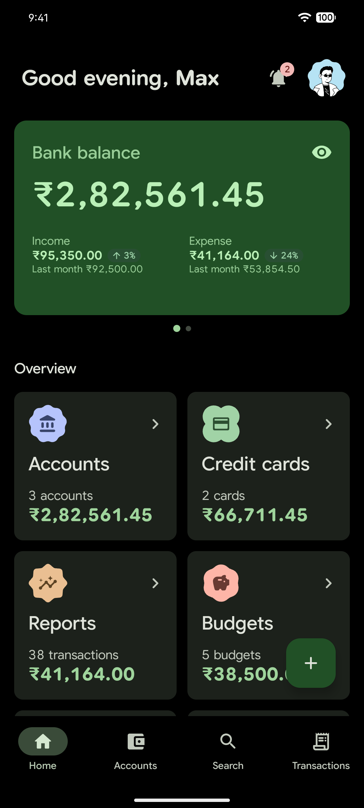
  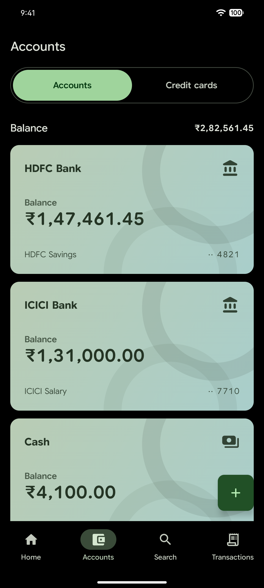
  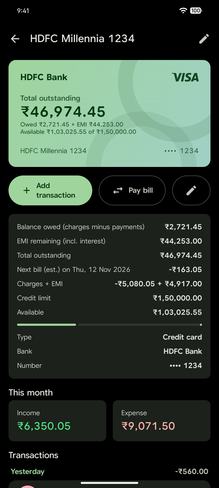
  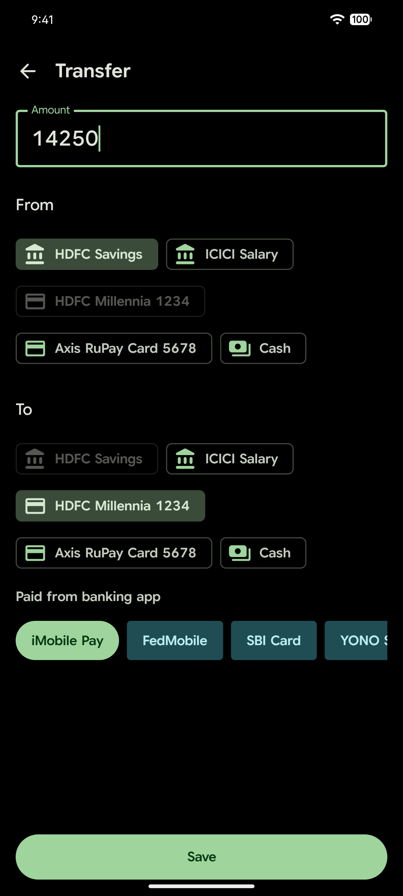
</p>

## Overview

paisa+ tracks accounts, spending and budgets without an account or a server. It reads bank alerts on the phone, turns them into transactions you review, and keeps all of it in a local database. It stays compatible with Paisa's JSON backups, so existing data moves across.

## Features

| | |
|---|---|
| **Money** | Bank, cash and credit card accounts, transactions, categories with budgets, monthly reports |
| **Transfers** | Between your own accounts and for credit card bills, from the **+** menu or **Pay bill** on a card; any transaction can be turned into a transfer afterwards |
| **Commitments** | Loans and card EMIs, debts (lending and borrowing), recurring rules |
| **People** | Everyone you pay or get paid by, with the other names bank messages and payment apps use for them. Set a category for all of a person's transactions at once |
| **Messages** | Offline SMS, Gmail and banking-app notification parsing with a local model and a review inbox. UPI and Pix app notices (Google Pay, PhonePe, Paytm, super money, Nubank and others) tag the app and the full payee name |
| **Scanning** | Past-SMS scan with a live log of what was done with each message and why |
| **Data** | Statement CSV import, versioned JSON backup and restore, restore from Flutter Paisa backups |
| **App** | App lock, home-screen widgets, Material You theming, update notifications |

## Screenshots

Shown with sample data.

| | | |
|---|---|---|
| 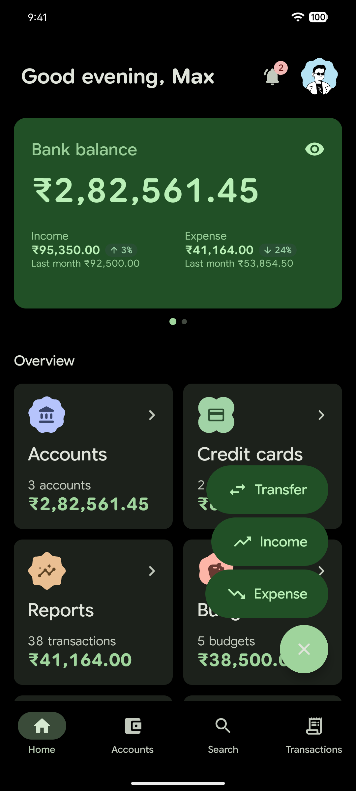<br>Add menu with Transfer | 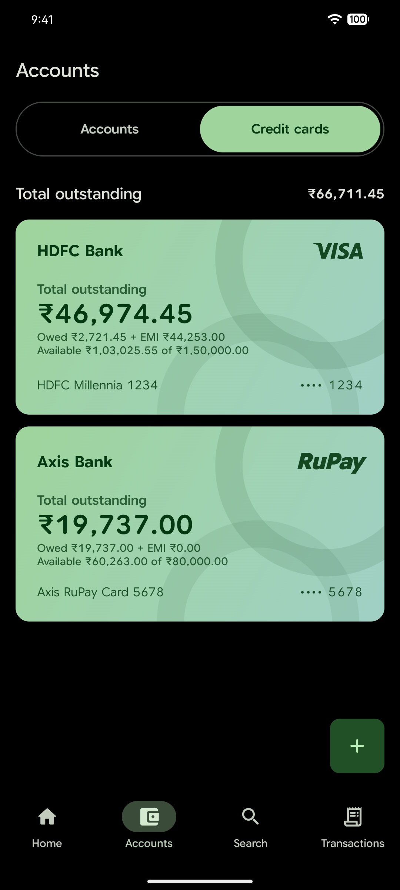<br>Credit cards | 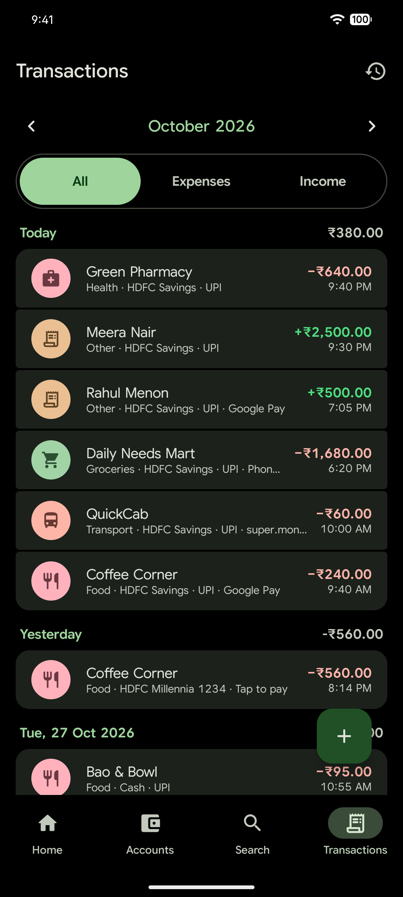<br>Transactions |
| 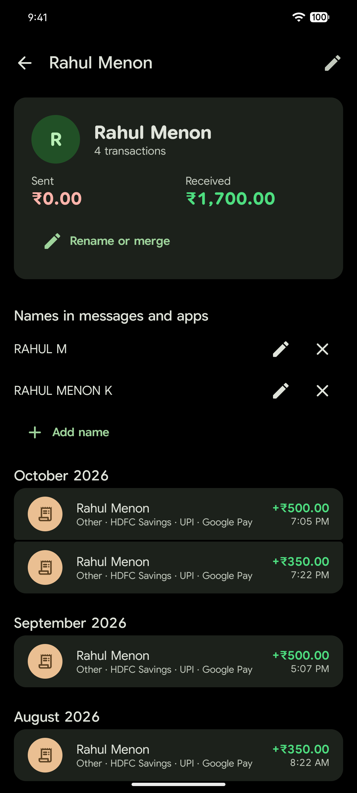<br>A person and the names bank alerts use for them | 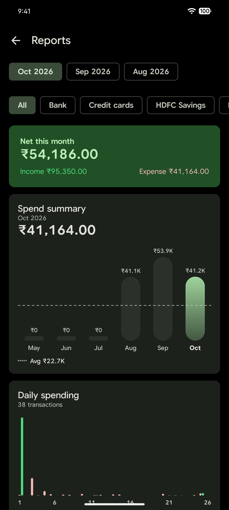<br>Reports | 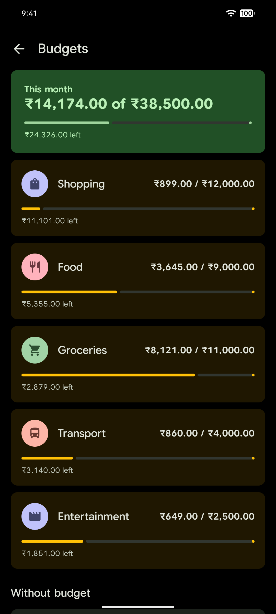<br>Budgets |
| 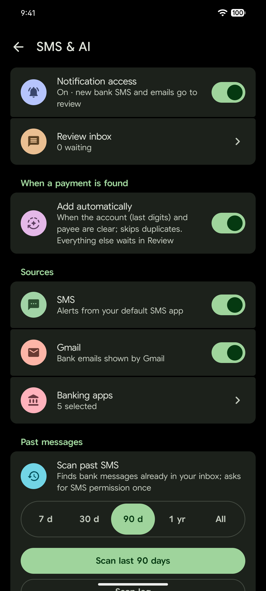<br>SMS and banking-app sources | 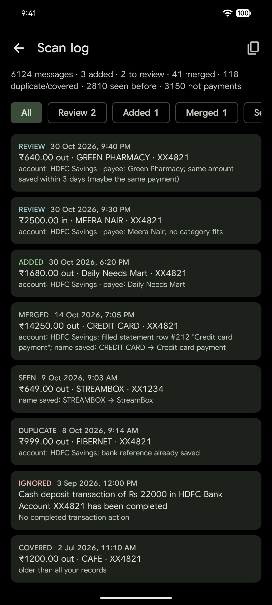<br>Scan log | 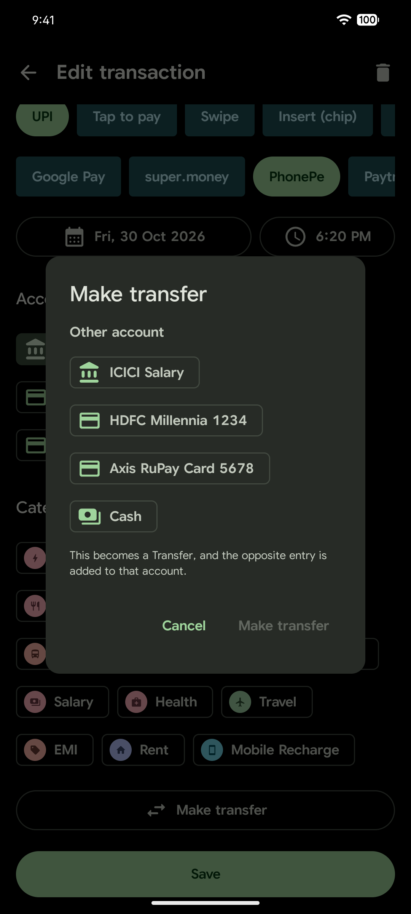<br>Turn a transaction into a transfer |

The profile picture is from [DiceBear](https://www.dicebear.com/) (Notionists by Zoish, CC0).

## Privacy

No account, no analytics, no cloud. Transactions, accounts and settings live only on the device, and no message text is sent to a server. The network is used only for what you ask for: checking GitHub for app updates and downloading the optional AI model.

## Local message parsing

The one-time **Auto** setup lets you download the optional model, import its ZIP, or skip and use the built-in parser. You can change this later.

Open **Settings → SMS & AI** to enable notification access, pick the banking apps whose notifications are read, scan past SMS, or paste an INR banking alert. Review detected payments and choose an account and category before saving. This supports new notifications and past SMS, not full Gmail inbox sync. An [optional downloadable AI model](tools/message_model/optional-model.md) can produce experimental local drafts; the built-in parser works without it. Model source and reference: [banking-sms-json-parser-v8](https://huggingface.co/rawsun00001/banking-sms-json-parser-v8). See [model training and limitations](tools/message_model/README.md) and [mock messages for 50 Indian banks](tools/message_model/bank-mock-messages.md).

## Build

Requires JDK 21 and Android SDK 37.

```sh
./gradlew installDebug       # debug build on a connected device
./gradlew testDebugUnitTest  # unit tests
```

For signed APKs/AABs, local `keystore.properties`, or an existing signing key in the manually triggered GitHub Actions workflow, see [release builds](docs/release-builds.md).

## Credits

paisa+ is based on [Paisa](https://github.com/h4h13/paisa) by **Hemanth S** ([@h4h13](https://github.com/h4h13)). The original app was written in Flutter; paisa+ ports its features and data model to native Compose. All credit for the original idea, design and app goes to the Paisa project.

Special thanks to Misfit ([@SriKousik](https://github.com/SriKousik)) for the notification AI. The model is based on [banking-sms-json-parser-v8](https://huggingface.co/rawsun00001/banking-sms-json-parser-v8) on Hugging Face.

## License

GPL-3.0, same as the original Paisa. See [LICENSE](LICENSE).
